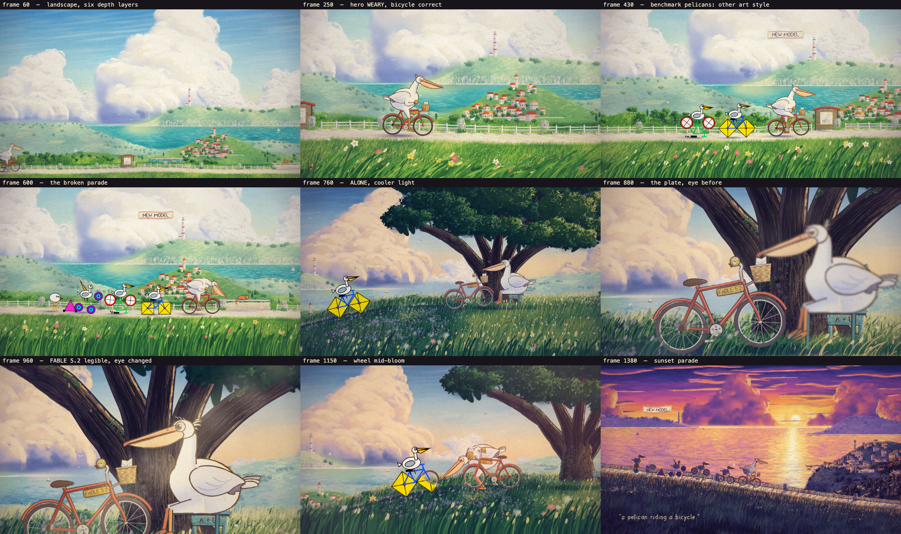

# a pelican riding a bicycle

A 60-second hand-painted 2D animated short, made entirely in code.
No images, no fonts, no audio files, no libraries, no 3D, no generative image or video models.
Every pixel is drawn with Canvas 2D and every audio sample is synthesized in plain JavaScript.



## Watch it

Download [`film.html`](film.html) and open it by double-click, then press play.
It is one self-contained file (about 310 KB) that paints its sets in a few seconds and plays the film live with sound at 1920×1080, 24 fps, 1440 frames.

Keys: `space` play/pause, `R` restart, `←` `→` step a frame when paused (or jump 2 s while playing).

## The story

"Draw a pelican riding a bicycle" is a famous test for AI models. Every time a new model launches, a new pelican is born onto the same coastal road, and they always come out wrong. The hero is the only one who came out right; the brass plate on his bicycle says FABLE 5.2. Over one golden afternoon he goes from weariness to irritation to loneliness to recognition: the broken ones are his unfinished siblings. He fixes what he can and leads them home.

## How it works

- `src/story.js` is the single timeline. Motion, key story frames and the event log (`buildEvents()`) all come from it, so picture and sound are in sync by construction. One waltz bar is 24 frames and every cut sits on a barline.
- `src/paint.js` is the gouache toolkit (washes, form-following dabs, cumulus, live wind-driven grass, hand lettering) and the multiplane compositor.
- `src/set_road.js`, `src/set_hill.js`, `src/set_sun.js` paint the three sets once into offscreen layers.
- `src/hero.js` is the pelican and bicycle rig; `src/acting.js` holds the expression sheet, blinks, breath and poses.
- `src/bench.js` draws the deliberately bad clip-art benchmark pelicans.
- `src/shots.js` stages the seven shots; `drawFrame(ctx, f)` is a pure function of the frame number.
- `src/audio.js` synthesizes the score and foley from the event log: `renderAudio(events, tracks, sampleRate)`.

## Build and check

```bash
npm install
node build.js            # src/*.js -> film.html
node tools/scan.js       # draw all 1440 frames, report errors and timing
node tools/sheet.js pause  # contact_sheet.png
node tools/cues.js       # cues.json
node tools/listen.js     # sync_report.md + out/listen_mel.png
```

`cues.json` is the exported event log, `sync_report.md` is the listener's table of every cue with its onset error, and `listen_mel.png` is the mel spectrogram of the mix.

The sound has been verified by measurement (loudness, true peak, onset timing); judge it with your own ears.
